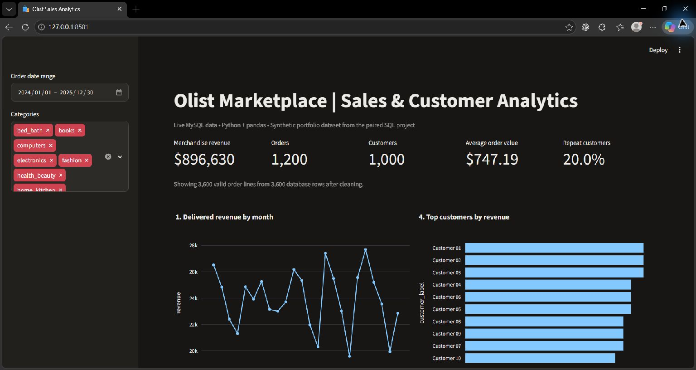
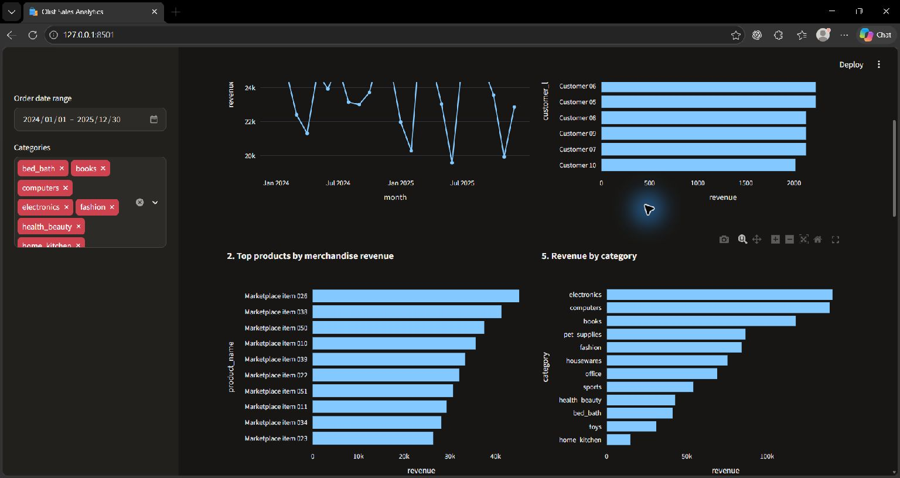
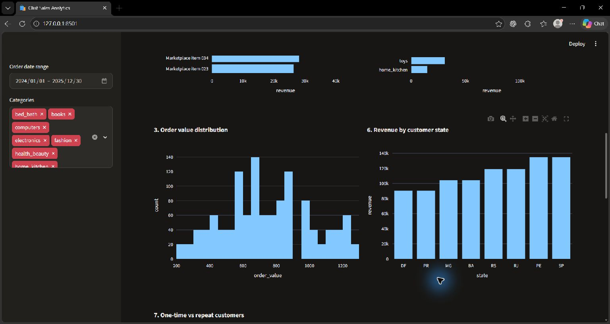
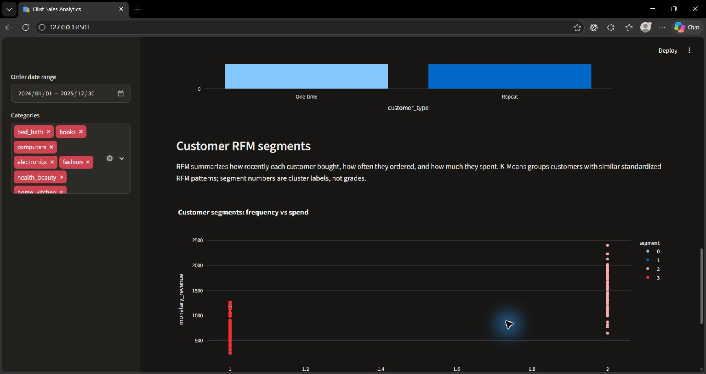

# Olist Marketplace Analytics — Python + MySQL + Streamlit

An end-to-end portfolio project that reads the paired `olist_resume_analytics` MySQL database, cleans order-line data with pandas, explores marketplace performance, clusters customers with RFM + K-Means, and serves interactive charts in Streamlit.

> The SQL portfolio uses deterministic synthetic records inspired by the Brazilian marketplace domain; this project does not claim the rows are from Olist's original public dataset. Database credentials stay in a local `.env`, which is ignored by Git. No raw data exports are committed.

## Business problem

Marketplace analysts need to track delivered revenue, product/category mix, customer concentration, repeat purchasing, and customer value. This app joins order, customer, item, product, and category tables to build a filtered dashboard and customer segments from the same MySQL model.

## Stack and architecture

- MySQL 8.0 / MySQL Workbench: normalized source tables
- SQLAlchemy + mysql-connector-python: parameterized connection and reads
- pandas: type fixes, duplicate/invalid-row handling, metrics and groupby summaries
- Plotly: seven interactive views
- scikit-learn: standardized RFM features and K-Means customer clusters
- Streamlit: date/category filters and KPI dashboard
- pytest: focused tests for cleaning, metrics, and RFM output

```text
MySQL tables → SQLAlchemy read → pandas cleaning → analysis + RFM → Streamlit dashboard
                    .env (local only; never commit)
```

## Database and business decisions

Defaults to schema `olist_resume_analytics`, created by the companion SQL project. The query joins the seven normalized tables through `orders → customers`, `orders → order_items`, `order_items → products`, and `products → categories`. Revenue is recomputed from quantity × purchase-time unit price − discount. This preserves historical item price and avoids counting a joined order multiple times in order-level KPIs.

Cleaning rules: parse invalid dates as missing, exclude rows missing keys/date/category, remove duplicate `(order_id, item_number)` lines, fill missing discount with zero (the schema default), exclude negative quantities/prices/discounts and discounts exceeding gross value, and recalculate line revenue. Large values are not dropped automatically: a high-value sale may be real, so investigate it rather than silently deleting it.

## Verified sample insights

I checked the paired schema in MySQL Workbench 8.0 CE. Its seven base tables contain 8,272 rows in total: 12 categories, 1,000 customers, 1,200 orders, 3,600 order items, 1,200 payments, 60 products, and 1,200 shipments. The database also exposes two analytics views.

Workbench query results show that **computers** led delivered merchandise revenue among the returned categories (86,865.60 source amount units), followed by **electronics** (81,915.60) and **books** (76,026.80). The monthly sales view covers January–December 2024; January was highest at 26,522.12 and April lowest at 21,308.32. Delivered order counts ranged from 32 to 37 per month. These are findings from the paired synthetic portfolio database, not claims about Olist's original public data.

### Live dashboard snapshot

These screenshots were captured from the running Streamlit app connected to the local `olist_resume_analytics` schema. With the default date and category filters, the dashboard showed **$896,630 merchandise revenue**, **1,200 orders**, **1,000 customers**, **$747.19 average order value**, **20.0% repeat customers**, and **3,600 valid order lines**. Electronics and computers led the category chart. These are results from the synthetic portfolio database, not Olist's original public dataset. The customer chart uses ranked labels instead of exposing customer IDs.









## Dashboard questions

1. How does delivered revenue move month to month?
2. Which products and customers contribute the most sales?
3. Which categories and customer states drive revenue?
4. What does order value distribution look like?
5. How many customers return for more than one order?
6. Which customer groups are recent, frequent, and high spending?

Charts in the dashboard are generated from live database output. The screenshots above show sample output from this project database and filter selection.

## Setup and run

1. Install Python 3.11 or newer and MySQL 8.0. Make sure the companion schema and seed script have been run in Workbench.
2. Open a terminal in this folder and create a virtual environment:

   ```powershell
   python -m venv .venv
   .\.venv\Scripts\Activate.ps1
   python -m pip install -r requirements.txt
   ```

3. Copy `.env.example` to `.env` and enter your MySQL host, port, schema, username, and password on your own machine. The app never prints the password. Do not commit `.env`.
4. Start the dashboard:

   ```powershell
   streamlit run src/app.py
   ```

5. Select a date range and product categories in the left sidebar. KPIs and charts update from the filtered records.
6. Run the basic tests:

   ```powershell
   python -m pytest
   ```

If you don't have the SQL project yet, use the companion `olist-ecommerce-sql-portfolio` repository and run its `schema/01_schema.sql`, `schema/02_analytics_objects.sql`, and `data/02_seed_data.sql` in that order. These scripts create/reset only the dedicated project schema, not unrelated databases.

## Concepts in this project

- **Virtual environment:** isolates this project's Python packages so another app can use different versions.
- **SQLAlchemy URL:** the connection URL is built from environment variables. `URL.create` handles special characters in a password without concatenating it into source code.
- **pandas cleaning:** `to_datetime(..., errors="coerce")` makes malformed dates explicit as missing values; required fields are filtered before grouping.
- **groupby:** totals order lines by month/category/state/customer; `nunique` counts an order once even when it contains several items.
- **RFM:** recency is days since the last purchase, frequency is distinct orders, monetary is revenue. Log scaling and standardization make the different numeric ranges comparable before K-Means.
- **Streamlit:** controls and KPI values are recalculated on each filter interaction.
- **Git hygiene:** `.env` and raw extracts are ignored; `.env.example` documents required variable names without real secrets.

## Limitations

The companion dataset is synthetic and small, so clusters are for learning rather than production targeting. The dashboard's revenue is merchandise line revenue; shipping/tax are outside the source schema. Cluster numbers are arbitrary labels, and K-Means assumes roughly compact numeric groups. A live connection is needed to display actual dashboard outputs.

## Resume bullets

- Built a MySQL-to-Streamlit analytics app with SQLAlchemy and pandas, applying documented type, duplicate, null, and business-validity checks to marketplace order lines.
- Developed seven interactive sales/customer charts and filterable KPI metrics while preventing join fan-out with distinct-order aggregation.
- Created RFM customer features and standardized K-Means segments, secured database settings with environment variables, and added pytest coverage for core analysis logic.
